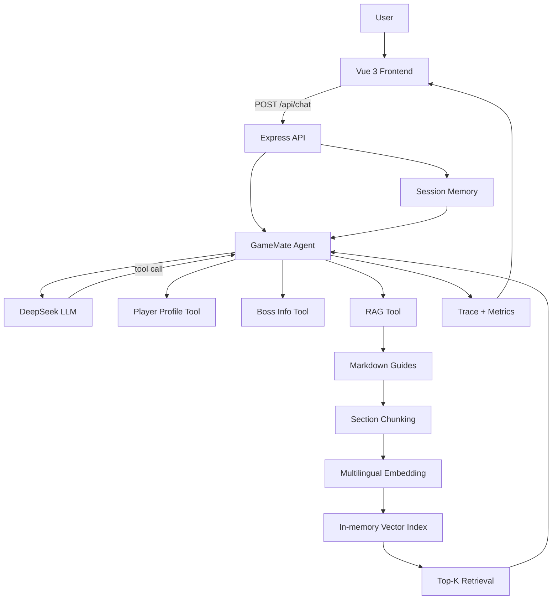

# GameMate

> A lightweight AI game assistant built with **Vue 3 + Node.js + DeepSeek + Tool Calling + RAG + Conversation Memory**.

GameMate is a small AI application engineering project that explores how an LLM can act as a decision layer instead of only generating text.  
The Agent can decide when to query player state, structured Boss data, or a local game-guide knowledge base, then combine the results into personalized game advice.

## Features

- **LLM Agent Loop** — the model can decide whether to answer directly or call one or more tools.
- **Tool Calling**
  - `get_current_player_profile`: query the current player's level, weapon, progress and area.
  - `get_boss_info`: query structured Boss information.
  - `search_game_guides`: retrieve game-guide knowledge through RAG.
- **RAG**
  - Markdown guide knowledge base.
  - Section-aware chunking that keeps headings and body text together.
  - Local multilingual embeddings with `@huggingface/transformers`.
  - Normalized vectors + dot product for cosine-similarity retrieval.
  - Top-K retrieval returned to the Agent as tool observations.
- **Conversation Memory**
  - Session-based short-term history.
  - Sliding window keeps the most recent messages to control context growth.
- **Agent Trace**
  - Frontend displays tool calls and retrieved RAG snippets.
- **Evaluation**
  - Small offline evaluation set covering player queries, Boss queries, RAG, multi-tool tasks and conversation memory.
- **Observability**
  - Tracks LLM calls, tool calls and end-to-end latency.

## Architecture



## Agent Workflow

For each user message:

1. Express loads the current session history.
2. The Agent sends the system prompt, history and current user message to the LLM.
3. The LLM either:
   - answers directly, or
   - requests one or more tools.
4. Node.js executes the requested tools.
5. Tool results are appended to the conversation as observations.
6. The Agent continues until the model produces a final answer.
7. The server stores the latest user/assistant messages in the session history.

The Agent loop has a maximum step limit to prevent abnormal infinite tool calling.

## RAG Design

Game guides are stored under:

```text
backend/data/guides/
```

The retrieval pipeline is:

```text
Markdown
  -> Section-aware Chunking
  -> Multilingual Embedding
  -> Normalized Vectors
  -> Cosine Similarity
  -> Top-K Results
  -> Agent
```

The current implementation uses an **in-memory vector index** and linear scan because the knowledge base is intentionally small.

For a larger production system, this layer could be replaced with a persistent vector store such as pgvector, Milvus, FAISS or another ANN solution.

## Why Tool Calling and RAG Are Both Used

The project intentionally separates different kinds of information:

| Information | Mechanism | Example |
|---|---|---|
| User-specific structured state | Tool | level, weapon, current progress |
| Stable structured game facts | Tool | Boss weakness, recommended level |
| Unstructured strategy knowledge | RAG | progression routes, weapon tips, preparation advice |
| Recent dialogue context | Conversation Memory | "that weapon", "that area", previous user choices |

This keeps the LLM from inventing user state while still allowing flexible retrieval from unstructured guides.

## Evaluation

The project includes a small offline evaluation set in:

```text
backend/src/eval.js
```

Current cases cover:

1. Player-state query.
2. Boss structured-data query.
3. RAG progression query.
4. Multi-tool personalized strategy query.
5. Conversation-memory query.

The evaluation checks whether expected tools are used and, where applicable, whether required answer keywords are present.

> This is a small engineering regression suite, not a claim of production-level accuracy.

During development, the evaluation exposed two useful issues:

- **Tool over-calling** — the Agent sometimes called more tools than necessary.
- **Chunk fragmentation** — splitting Markdown too aggressively produced high-similarity but low-information chunks.

The project was then adjusted with a stricter tool-routing policy and section-aware Markdown chunking.

## Project Structure

```text
GameMate/
├─ backend/
│  ├─ data/
│  │  └─ guides/          # Markdown RAG knowledge base
│  ├─ src/
│  │  ├─ agent.js         # Agent loop + tool schemas + metrics
│  │  ├─ tools.js         # Player/Boss structured tools
│  │  ├─ rag.js           # Embedding + vector retrieval
│  │  ├─ server.js        # Express API + conversation memory
│  │  ├─ eval.js          # Offline evaluation
│  │  └─ test-rag.js      # RAG test script
│  ├─ .env.example
│  └─ package.json
│
├─ frontend/
│  ├─ src/
│  │  └─ App.vue          # Chat UI + Markdown + Agent Trace
│  └─ package.json
│
└─ README.md
```

## Tech Stack

### Frontend

- Vue 3
- Vite
- Marked
- DOMPurify

### Backend

- Node.js
- Express 5
- OpenAI-compatible SDK
- DeepSeek API
- `@huggingface/transformers`
- Local multilingual MiniLM embeddings

## Local Setup

### 1. Clone

```bash
git clone https://github.com/Phr0033/GameMate.git
cd GameMate
```

### 2. Configure Backend

```bash
cd backend
npm install
```

Create `backend/.env`:

```env
DEEPSEEK_API_KEY=your_deepseek_api_key
DEEPSEEK_BASE_URL=https://api.deepseek.com
DEEPSEEK_MODEL=your_available_model
```

Use a model available to your own DeepSeek account/configuration.

Start the backend:

```bash
npm run dev
```

Default backend address:

```text
http://localhost:3000
```

Health check:

```text
GET /api/health
```

### 3. Start Frontend

Open another terminal:

```bash
cd frontend
npm install
npm run dev
```

The frontend sends chat requests to:

```text
http://localhost:3000/api/chat
```

## Run Evaluation

From `backend/`:

```bash
node src/eval.js
```

The evaluation performs real Agent calls, so it requires a valid LLM API configuration.

## API Example

```http
POST /api/chat
Content-Type: application/json
```

```json
{
  "userId": "u001",
  "sessionId": "demo-session",
  "message": "我刚击败森林守卫，接下来应该去哪？结合我的等级和武器给我建议。"
}
```

The response includes the final answer, used tools, Agent trace and metrics.

## Current Limitations

This repository is an MVP intended for AI application engineering practice and demonstration.

- Player and Boss data are currently mock data.
- Conversation memory is stored in a Node.js `Map` and is lost after server restart.
- The vector index is rebuilt in memory after process restart.
- Retrieval currently performs a linear scan and is designed for a small knowledge base.
- Evaluation coverage is intentionally small.
- Authentication, rate limiting, persistent logging and production sandboxing are not implemented here.

## Possible Next Steps

- Persist short-term session state with Redis.
- Store conversations and user state in PostgreSQL.
- Replace the in-memory vector index with a production vector database.
- Add hybrid retrieval and reranking.
- Expand the evaluation dataset and retrieval metrics.
- Add streaming responses.
- Add authentication and derive `userId` from server-side identity instead of the frontend.

## Background

GameMate was built as a compact end-to-end AI application project focused on understanding and implementing the core engineering ideas behind:

**LLM Agent + Tool Calling + RAG + Embedding + Conversation Memory + Evaluation + Observability**

rather than relying on a large Agent framework to hide the underlying control flow.
